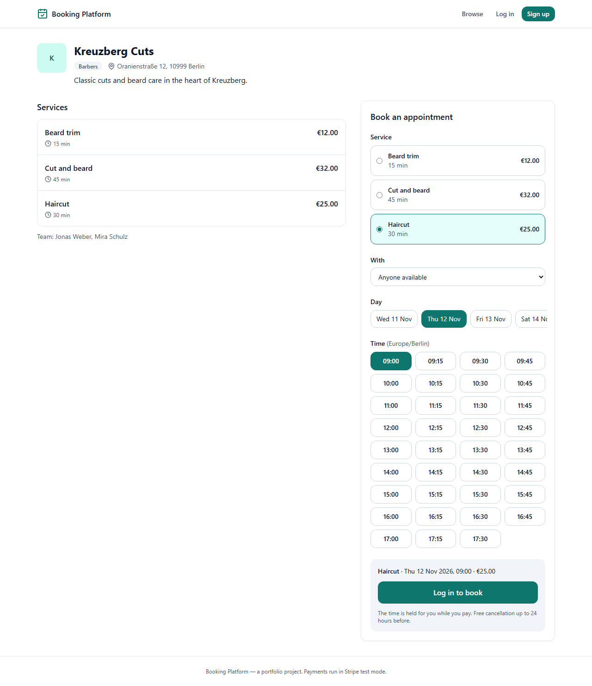
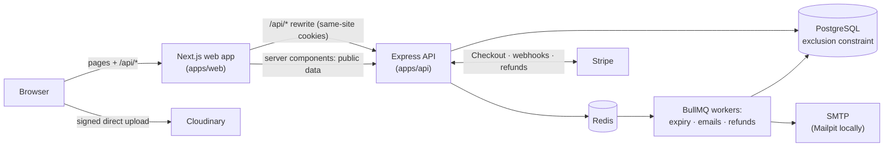
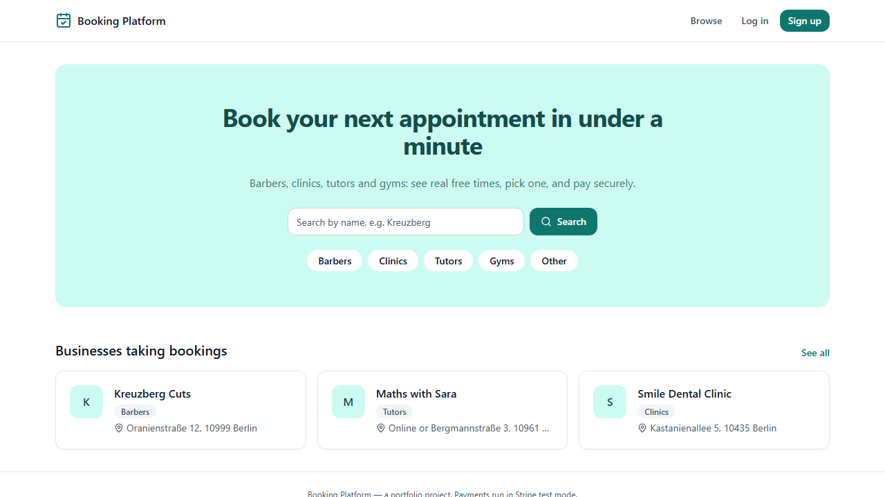
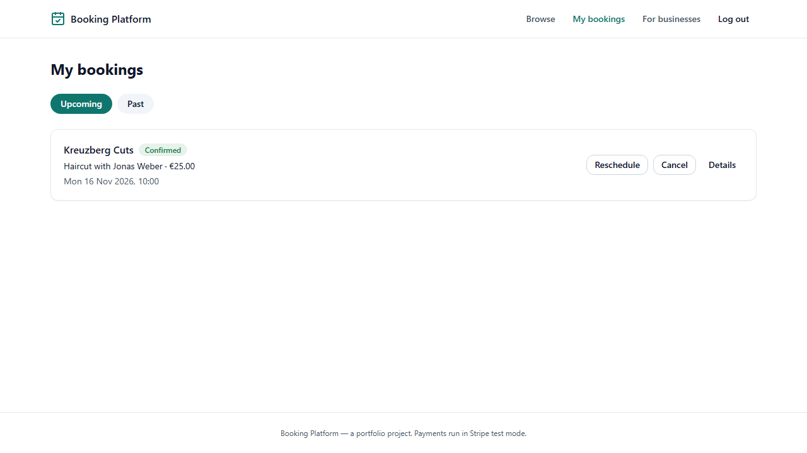
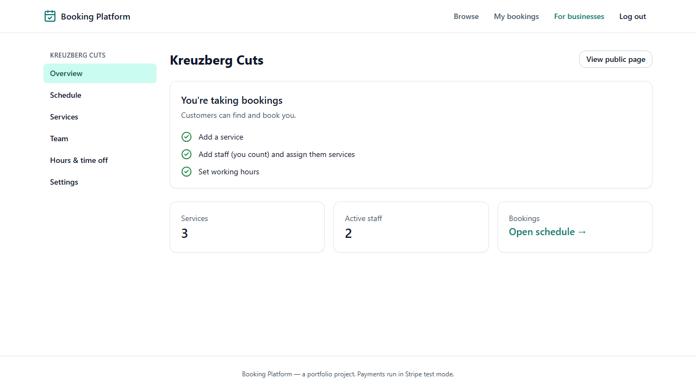
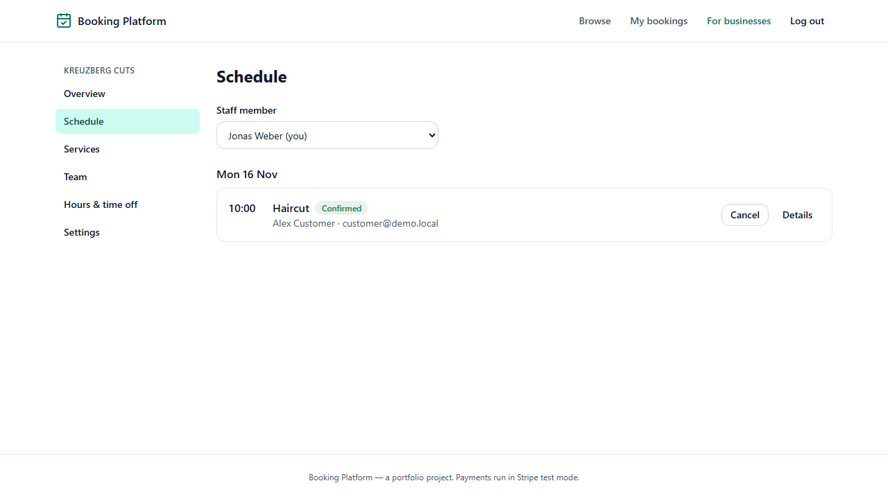
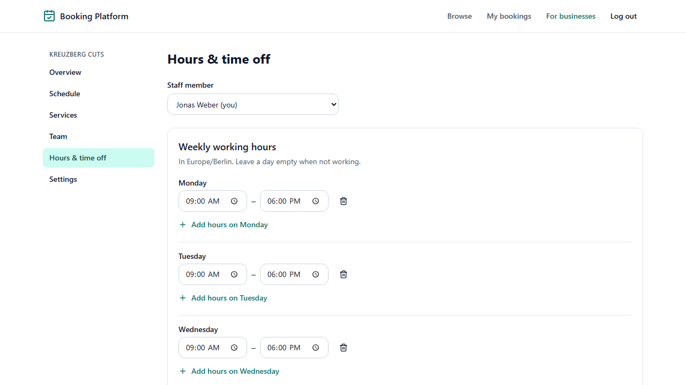
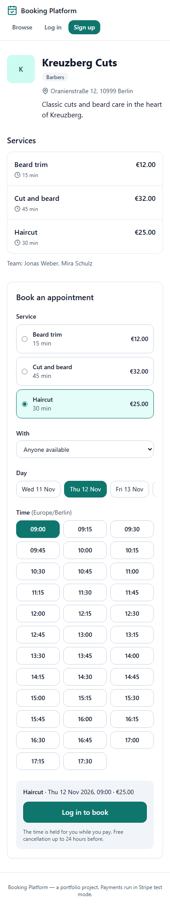

# Booking Platform

A booking platform for small businesses — barbers, clinics, tutors, gyms. Owners publish
services, staff and working hours; customers see real free times, book, and pay with
Stripe; staff manage their schedule.

> **Live demo:** not deployed yet. Run it locally in a few minutes (below) and log in with a
> demo account.



## Highlights

- **No double bookings, even under concurrent requests.** A PostgreSQL exclusion
  constraint on (staff, time range) is the final guarantee; a test fires 10 simultaneous
  requests at one slot and gets exactly one booking.
  ([ADR 0001](docs/decisions/0001-double-booking-prevention.md))
- **Time-zone-correct availability.** Working hours are stored as local wall-clock times;
  slots are calculated per business time zone and unit-tested across daylight-saving
  changes.
- **Payments confirmed only by Stripe's webhook**, applied exactly once (inbox pattern),
  with automatic refunds for cancellations and late payments.
  ([ADR 0005](docs/decisions/0005-payments.md))
- **Own auth:** bcrypt, 15-minute JWT + rotating refresh token with reuse detection, in
  httpOnly cookies. The web app proxies the API so cookies stay first-party.
  ([ADR 0002](docs/decisions/0002-auth-sessions.md), [ADR 0009](docs/decisions/0009-same-origin-api.md))
- **Background jobs with safety nets:** payment-window expiry, emails, 24-hour reminders
  and refunds on BullMQ, each with a fallback if Redis was down.
  ([ADR 0003](docs/decisions/0003-job-queue.md))
- **Measured before optimising:** slots take p95 19.5 ms with 2,700 bookings, so they are
  deliberately not cached. ([ADR 0006](docs/decisions/0006-no-slot-cache.md))
- **One set of validation rules:** Zod schemas shared by the API, the forms and the
  generated OpenAPI docs. ([ADR 0004](docs/decisions/0004-monorepo.md))

## Features

| Customers                                      | Business owners & staff                                 | Admins                          |
| ---------------------------------------------- | ------------------------------------------------------- | ------------------------------- |
| Browse and search businesses                   | Create a business page, logo and cover image            | Platform stats                  |
| See free times, book, pay (Stripe Checkout)    | Services with duration, buffer and price                | Search users                    |
| Reschedule or cancel (refund if paid)          | Team: invites by email, services per person, deactivate | Suspend / reactivate businesses |
| Confirmation, reminder and cancellation emails | Weekly working hours and time off                       |                                 |
| Email verification, password reset             | Schedule; mark bookings completed / no-show             |                                 |

## Architecture



- **`apps/api`** — Express 5, Prisma 7, PostgreSQL, Redis + BullMQ, Pino, Zod. Layered as
  route → controller → service → Prisma. OpenAPI docs at `/docs`.
- **`apps/web`** — Next.js 16 (App Router), React 19, Tailwind CSS v4, TanStack Query,
  React Hook Form. ([ADR 0010](docs/decisions/0010-frontend.md))
- **`packages/shared`** — Zod schemas and types used by both.

## Getting started

Requirements: Node 22+, pnpm 10, Docker.

```bash
pnpm install
docker compose up -d                       # Postgres (port 5440), Redis, Mailpit
cp apps/api/.env.example apps/api/.env     # then fill in JWT_ACCESS_SECRET (see the file)
pnpm --filter api db:generate
pnpm --filter api db:migrate
pnpm --filter api db:seed                  # demo businesses and accounts
pnpm dev                                   # API on :4000 and web app on http://localhost:3000
```

Stripe needs test-mode keys in `apps/api/.env` (`sk_test_…`); placeholders let everything
else run. For webhooks locally: `stripe listen --forward-to localhost:4000/webhooks/stripe`.

| Demo account          | Password            | What to try                         |
| --------------------- | ------------------- | ----------------------------------- |
| `customer@demo.local` | `demo-password-123` | Book, reschedule, cancel            |
| `owner@demo.local`    | `demo-password-123` | Dashboard of "Kreuzberg Cuts"       |
| `barber@demo.local`   | `demo-password-123` | A staff member's schedule and hours |
| `admin@demo.local`    | `demo-password-123` | Platform admin                      |

- Emails sent locally: <http://localhost:8025> (Mailpit)
- API docs: <http://localhost:4000/docs>

## Tests

```bash
pnpm --filter api test        # 163 unit + integration tests (Vitest + Supertest, real Postgres/Redis)
pnpm --filter web test:e2e    # Playwright: booking flow, session refresh, owner flow, phone layouts
pnpm lint && pnpm typecheck && pnpm format:check
```

The end-to-end suite starts the real API and a production build of the web app against
their own database, seeded with the demo data. CI runs everything on every push
(`.github/workflows/ci.yml`).

## Screenshots

|                                                      |                                                            |
| ---------------------------------------------------- | ---------------------------------------------------------- |
|                    |            |
|    |                  |
|  |  |

## Decisions

Every significant choice has a short record in [`docs/decisions`](docs/decisions): the
context, what was decided, the alternatives, and the consequences.
